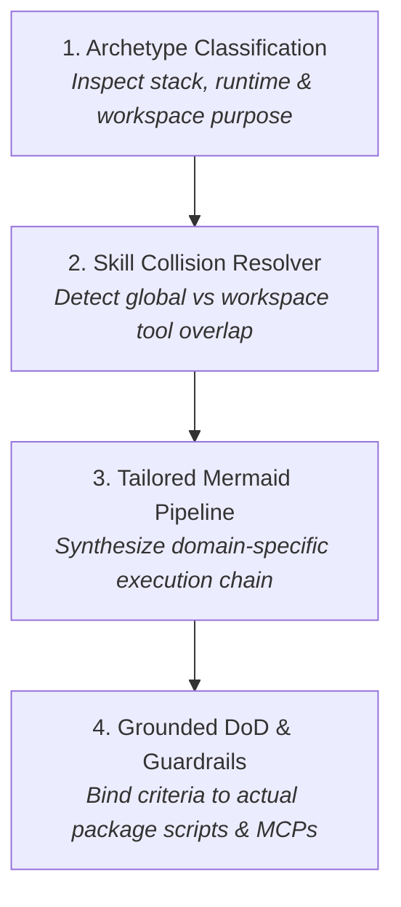
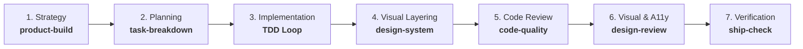

# ⚡ init-gemini

> **The Principal Software Architect & Flight Manual Synthesizer for Google Antigravity (AGY).**  
> Audits any codebase, resolves skill collisions, generates an adaptive Mermaid execution pipeline, and synthesizes a high-density, production-grade `GEMINI.md` (<75 lines, zero token waste).

[](https://github.com/libragik/init-gemini)
[-brightgreen.svg)](https://github.com/libragik/init-gemini)
[](https://github.com/libragik/init-gemini)
[](https://github.com/libragik/init-gemini)

---

## 🎯 Why `init-gemini` Exists

Standard AI workspace initializers default to **"Catalog Clutter"**:
* ❌ They copy-paste long descriptions of installed skills into `GEMINI.md`, flooding your agent's context window with duplicate text on every single turn.
* ❌ They ignore **skill collisions**—when global tools (like Addy Osmani skills) and workspace plugins (like EliteKit) overlap on UI, reviews, or shipping, the agent suffers decision paralysis and hallucinated workflows.
* ❌ They provide flat lists with no sense of sequence, resulting in unverified code claims and missing acceptance proof.

**`init-gemini` transforms your agent into an Elite Pair Programmer:**
1. **Dynamic Skill Collision Engine**: When multiple skills overlap, it defines explicit precedence (e.g., local design kits command aesthetics; UI skills command component state).
2. **Adaptive Mermaid Pipeline**: Synthesizes a visual, step-by-step flowchart tailored to the project’s specific archetype.
3. **High-Density Flight Manual**: Produces a strictly governed `GEMINI.md` under 75 lines with zero redundant prose.
4. **Grounded Definition of Done**: Hardcodes exact compiler, linter, test commands, and active MCP tools (`chrome-devtools-mcp`, `github-mcp-server`).

---

## 🏗️ The 4 Architectural Pillars



### 1. Archetype Classification
Automatically identifies workspace types:
* **Frontend / Full-Stack / Webapp** (`Next.js`, `Vite`, `React`, `Vue`): Enforces feature colocation (`src/features/`), 1px micro-borders, 3-tier design tokens, 320px responsive reflow, and WCAG 2.2 AA (A1–A8).
* **Chrome Extension Builder / Multi-Extension Suite**: Enforces multi-extension isolation (`extensions/<name>/`). Every extension is self-contained with its own `manifest.json`, `package.json`, and `src/`. Root strictly reserved for workspace orchestration and tooling.
* **Standalone Chrome Extension (Manifest V3)** (`manifest.json`): Enforces strict isolation (`src/background/`, `src/content/`, `src/popup/`, `src/options/`), CSP compliance, and Chrome DevTools MCP. Root reserved for extension configs.
* **Script / Quant / Indicator Systems** (`Pine Script`, `Python Quant/Bot`, `MQL5`): Enforces self-contained bundles (`scripts/<System_Name>/`), companion manifests (engine, strategy, docs, spec), and zero-repainting gates.
* **Backend / API / Systems** (`FastAPI`, `Go`, `Rust`, `Express`): Enforces contract-first schemas, runtime validation at boundaries, domain modules (`src/modules/<name>/`), and test harnesses.
* **Antigravity Plugin / DevKit** (`plugin.json`, `.agents/plugins`): Enforces modular plugin isolation and cryptographic integrity verification.
* **Monorepo / Multi-Package**: Enforces boundary contracts (`apps/`, `packages/`) and scoped workspace testing.

### 2. Skill Collision & Overlap Resolution
When multiple toolkits intersect, `init-gemini` generates a deterministic resolution matrix:

| Domain | Collision Point | The Expert Resolution |
|---|---|---|
| **UI & Visual Craft** | Design Token Rule vs. UI Engineering Skill | **Local design kit leads aesthetic craft** (peer teardowns, 1px micro-borders, tabular numerals); UI engineering skill leads component boundaries & state hooks. |
| **Reviews & Audits** | Code Review Skill vs. Visual/A11y Review Skill | **Two-phase sequence**: Code review checks logic, types, and security; Visual review checks rendered DOM, contrast, and 320px reflow. |
| **Pre-Flight & Shipping** | Release Verification Gate vs. Cloud Deployer | **Verification skill owns readiness** (A1–A8 matrix + hash check); Deployment skill executes cloud/CI pipeline only after clearance. |
| **Architectural Decisions** | Verbose Documentation Skill vs. Lean ADR | **Enforce Lean 4-Line ADR** (*Context / Options / Chosen / Tradeoff*) to prevent repository bloat. |

### 3. Adaptive Mermaid Pipeline Generation
Generates a visual, sequential vertical slice tailored to your project:


### 4. Grounded Guardrails & Hardwired DoD
* **Zero Root Pollution & Directory Isolation**: Absolute ban on dumping loose source files, scripts, or docs into the root. Enforces archetype-tailored directory containment (`extensions/<name>/` for extensions, `apps/<name>/` or `websites/<name>/` for web apps and sites, `scripts/<Name>/` for Pine Script and quant systems, `services/<name>/` for APIs/backend).
* **Evidence Before Claims**: Never report `PASS` without concrete terminal output, DOM inspection, or computed proof.
* **Minimal Necessary Complexity**: Existing code > platform standards > bespoke code > evaluated dependencies.
* **Anti-AI Slop**: Hard bans generic buzzwords (*delve*, *streamline*, *testament*, *seamlessly*) and fabricated testimonials.

---

## 🚀 Installation (1 Command)

### Global Installation (Recommended)
Make `init-gemini` available across every workspace on your machine:

```powershell
# Windows (PowerShell):
git clone --depth 1 https://github.com/libragik/init-gemini.git "$HOME\.gemini\config\skills\init-gemini"

# macOS / Linux:
git clone --depth 1 https://github.com/libragik/init-gemini.git ~/.gemini/config/skills/init-gemini
```

### Single-Workspace Installation
Install strictly inside a specific project:

```bash
git clone --depth 1 https://github.com/libragik/init-gemini.git .agents/skills/init-gemini
```

---

## 💻 Usage

In your Antigravity chat or terminal, simply type:

```text
/init-gemini
```

`init-gemini` audits your workspace and synthesizes an elite `./GEMINI.md` flight manual in seconds.

---

## 📊 Before vs. After Comparison

| Metric | Typical AI Initializer | `init-gemini` Synthesizer |
|---|---|---|
| **File Length** | 150–300 lines of redundant fluff | **45–70 lines** of high-density directives |
| **Skill Conflict Handling** | Ignored (Agent suffers confusion) | **Explicitly resolved** in an Overlap Matrix |
| **Execution Flow** | None (Agent guesses order) | **Visual Mermaid flowchart** tailored to stack |
| **Quality Verification** | Abstract "ensure it works" | **Hardwired test commands & MCP checks** |
| **Token Cost / Turn** | Heavy context tax | **Minimal, progressive disclosure** |

---

## 👨‍💻 Author & License

* **Author**: Muhammad Rafiq ([@libragik](https://github.com/libragik))
* **License**: MIT License — open, modular, and free for enterprise or personal use.
